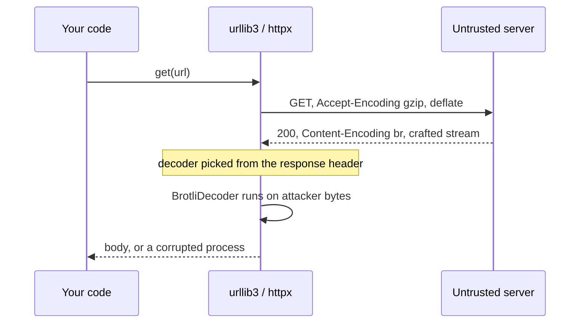

You have never written `import brotli`. Nobody on your team has. But somewhere in last quarter's dependency bump, an SDK pulled in the `brotli` wheel as a convenience, and from that moment every `requests.get()` in your service became willing to hand attacker-chosen bytes to a C decompressor.

That used to be a performance footnote. As of **CVE-2026-111497**, disclosed by Node.js on October 21 and in a GitHub advisory for the PyPI packages on October 22, it is a memory-corruption bug. The CVE record rates it **9.2 Critical** under CVSS v4.0; Node.js calls the same flaw "high". Either way, the interesting part is not the score — it is how the bug reached your process without anyone deciding it should.

## A boolean that meant two different things

The flaw lives in `DecodeBlockTypeAndLength()` in Brotli's `c/dec/decode.c`. Before the fix, that function returned a `BROTLI_BOOL`. `false` meant *either* "this stream is malformed" *or* "I need more input to finish reading this symbol". As Aikido's write-up puts it, "Callers can't tell the two apart, and on the fast path the decoder discards the return value entirely."

Node.js's advisory spells out what happens next: "An invalid block switch was reported as a temporary need for more input instead of a permanent format error, so the streaming decoder kept appending input bytes to an eight-byte internal buffer." Keep feeding a streaming decoder that thinks it is waiting for more bytes, and it keeps writing them — past the end of eight bytes of buffer. The CVE carries both weakness classes that story implies: **CWE-252** (unchecked return value) and **CWE-787** (out-of-bounds write).

The upstream fix, commit `0ed4268`, is almost anticlimactic. The function now returns a `BrotliDecoderErrorCode`, distinguishing `BROTLI_DECODER_NEEDS_MORE_INPUT` from a new `BROTLI_DECODER_ERROR_FORMAT_BLOCK_SWITCH` (-17), which takes over a slot the header had marked as reserved. Its commit title: "Detect and report invalid stream earlier." According to Aikido, the root cause "was fixed in the Brotli source code in February, but it wasn't recognized as a security issue at the time" — and no release carried the fix until the October disclosure.

Affected: upstream Brotli 1.0.3 through 1.2.0, fixed in 1.0.10, 1.1.1 and 1.2.1. On PyPI, GitHub advisory **GHSA-9v8h-qqgm-4m35** covers `brotli` below 1.2.1 and `brotlicffi` below 1.2.1.0.

## Four clients, one import probe

Here is the part that should change how you think about it. None of the major Python HTTP clients make Brotli a hard dependency. Each one *probes* for it at import time and quietly switches on decoding if the probe succeeds.

| Client | How it decides | What it does when brotli imports |
| --- | --- | --- |
| urllib3 | `try: import brotlicffi` / `except ImportError: import brotli` | Appends `,br` to `ACCEPT_ENCODING`; returns a `BrotliDecoder` for `br` responses |
| requests | Inherits urllib3: `make_headers(accept_encoding=True)` | Same default `Accept-Encoding`, same decoder |
| httpx | `import brotli`, falling back to `brotlicffi`, else `brotli = None` | Keeps `"br"` in `SUPPORTED_DECODERS` and in the default `Accept-Encoding` |
| aiohttp | Sets `HAS_BROTLI` from the same import dance | Appends `"br"` to its default `Accept-Encoding` |

In httpx the switch is one line: `if brotli is None: SUPPORTED_DECODERS.pop("br")`. Install the package and that line simply does not run.

This is a reasonable design for performance — optional speedups should not be mandatory installs. It is a terrible design for knowing your attack surface, because the decision is made by whatever happens to be in `site-packages`, not by anything in your code or your lockfile's direct dependencies.

## The server decides, not your request

The obvious mitigation is to stop advertising `br`. It does not close the hole, and the reason is worth understanding. In urllib3, the decoder is chosen from the *response*: `if brotli is not None and mode == "br": return BrotliDecoder()`, where `mode` comes from the server's `Content-Encoding`. httpx does the same thing — it reads `content-encoding` from the response headers and looks each value up in `SUPPORTED_DECODERS`.

`Accept-Encoding` is a polite request. A hostile server is not obliged to honour it. Traced through a client that never asked for Brotli:



The request header and the decoder never consult each other. That is why Aikido's guidance pairs removing `br` from `Accept-Encoding` with *blocking Brotli responses before decoding* — the first step alone is not sufficient.

You can watch it happen with a local server. This local server ignores what the client asked for and answers with a valid, harmless Brotli body — no exploit, just the decoding path:

```python
"""A client that never asked for Brotli decodes it anyway.

Needs: pip install "brotli>=1.2.1" httpx requests
"""
import threading
from http.server import BaseHTTPRequestHandler, HTTPServer

import brotli
import httpx
import requests

BODY = brotli.compress(b"decoded by a decoder you never asked for\n")


class BrotliAnyway(BaseHTTPRequestHandler):
    def do_GET(self):
        print("  client sent Accept-Encoding:", self.headers.get("Accept-Encoding"))
        self.send_response(200)
        self.send_header("Content-Encoding", "br")  # ignores what the client asked for
        self.send_header("Content-Length", str(len(BODY)))
        self.end_headers()
        self.wfile.write(BODY)

    def log_message(self, *args):  # keep the output readable
        pass


server = HTTPServer(("127.0.0.1", 0), BrotliAnyway)
threading.Thread(target=server.serve_forever, daemon=True).start()
url = f"http://127.0.0.1:{server.server_port}/"
no_br = {"Accept-Encoding": "gzip, deflate"}

print("httpx:")
print("  got:", httpx.get(url, headers=no_br).text.strip())
print("requests:")
print("  got:", requests.get(url, headers=no_br, timeout=5).text.strip())
server.shutdown()
```

On httpx 0.28.1 and requests 2.32.3 (urllib3 2.2.3), both clients send `gzip, deflate` and both print the decoded sentence. Swap that harmless body for a crafted stream and an unpatched decoder is doing the writing.

The source advisory's exposure test is blunt: "You're exposed if any environment has Brotli 1.2.0 or earlier or brotlicffi 1.2.0.x installed." Where it bites hardest, in my reading, is code that fetches URLs it does not control.

## What an attack would look like

No exploitation in the wild had been reported as of October 22, so what follows is a hypothetical, built only from the mechanism above. It deliberately stops at *where* attacker bytes enter; how to craft the malformed stream is not something this post covers.

Say your SaaS lets customers register a webhook URL, and a worker POSTs events to it with `requests`. An attacker signs up and registers `https://hooks.attacker.example/in`. It resolves, speaks TLS and answers `200` — nothing looks hostile.

The attack is in the reply. Your worker never asked for Brotli; the attacker's server answers with `Content-Encoding: br` anyway and a body built to trigger the block-switch bug. urllib3 sees the header, finds `brotli` importable, and hands the body to the vulnerable decoder. Your worker does not even have to read the reply: without `stream=True`, `Session.send` touches `r.content` before returning, and `.content` streams the raw body with `decode_content=True`. The decoder runs inside the `requests.post()` call itself — fire-and-forget code included.

From there Node.js's own list of outcomes applies — "a crash, disclosure of process memory, or remote code execution" — inside your webhook worker, the process holding database credentials, webhook signing keys and API tokens. The attacker spent one sign-up and one HTTP server.

The same shape fits link previews and feed readers. The attacker never reaches into your network; your code reaches out to them and politely decompresses whatever comes back.

## Find out what your interpreter will actually do

Run this inside the environment that ships, not on your laptop — the whole point is that the answer depends on what got installed transitively.

```python
"""Report whether this interpreter will decode Brotli, and whether that decoder is patched."""
from importlib import metadata

# First fixed PyPI releases per GHSA-9v8h-qqgm-4m35 (CVE-2026-111497).
# Upstream also backported to 1.0.10 and 1.1.1, but the PyPI advisory's
# range is what matters for the wheel in your environment.
FIXED = {"brotli": (1, 2, 1), "brotlicffi": (1, 2, 1, 0)}
FIRST_AFFECTED = (1, 0, 3)


def as_tuple(version: str) -> tuple[int, ...]:
    # Good enough for these two packages' plain numeric versions.
    return tuple(int(part) for part in version.split(".") if part.isdigit())


for package, fixed in FIXED.items():
    try:
        version = metadata.version(package)
    except metadata.PackageNotFoundError:
        print(f"{package:11} not installed")
        continue
    v = as_tuple(version)
    if v < FIRST_AFFECTED or v >= fixed:
        verdict = "ok"
    else:
        verdict = "VULNERABLE, upgrade"
    print(f"{package:11} {version:10} {verdict}")

try:
    from urllib3.util.request import ACCEPT_ENCODING
    print(f"urllib3 (and requests) advertise: {ACCEPT_ENCODING}")
except ImportError:
    pass
```

If either line says `VULNERABLE`, the fix is `pip install -U "brotli>=1.2.1"` or `"brotlicffi>=1.2.1.0"`, then rebuild the image. Then run `pip show brotli` (or `pip show brotlicffi`) and read the `Required-by` line to see which dependency dragged it in — that is the package whose optional extras you are now trusting with untrusted input.

## A guard for the days you cannot upgrade yet

When a rebuild is blocked — a frozen base image, a vendor wheel pinned to an old `brotli` — refuse Brotli at the response boundary, before any body byte reaches the decoder. httpx makes this clean, because its response event hooks are "called before determining if the response body should be read or not":

```python
import httpx


def refuse_brotli(response: httpx.Response) -> None:
    # Runs after headers arrive and before the body is read or decoded.
    encodings = response.headers.get("content-encoding", "")
    if "br" in (e.strip().lower() for e in encodings.split(",")):
        response.close()
        raise httpx.DecodingError(
            "refusing Brotli-encoded response until brotli>=1.2.1 is deployed",
            request=response.request,
        )


client = httpx.Client(
    headers={"Accept-Encoding": "gzip, deflate"},  # stop asking for br...
    event_hooks={"response": [refuse_brotli]},     # ...and refuse it when sent anyway
    timeout=10,
)
```

With requests, the same idea uses `stream=True`, which downloads only the headers until you touch `.content`:

```python
import requests


def fetch_untrusted(url: str) -> bytes:
    headers = {"Accept-Encoding": "gzip, deflate"}
    with requests.get(url, headers=headers, stream=True, timeout=10) as r:
        encodings = r.headers.get("Content-Encoding", "")
        if "br" in (e.strip().lower() for e in encodings.split(",")):
            raise ValueError(f"refusing Brotli response from {url}")
        return r.content
```

The trade-off is real: a server that only speaks Brotli to you now fails loudly instead of working. That is the right failure for a fetcher pointed at untrusted URLs, and the wrong one for a client talking to an internal API you control — there, just upgrade. The guard is a tourniquet; the patched wheel is the fix. Uninstalling *both* `brotli` and `brotlicffi` also removes the decoding path; per Aikido, httpx, requests and urllib3 keep gzip and deflate without them. But "automatic fallback is not guaranteed": a server that sends Brotli anyway now gets you an unreadable response or an error, and anything you depend on that needs Brotli breaks with it.

## Optional dependencies are still dependencies

The bug itself is a classic: a return type too small to carry the distinction the caller needed. What made it a fleet-wide incident for Python shops is the import probe. Four clients, each making a defensible local decision, add up to a system where *installing* a package changes how untrusted network input is parsed — with no line of your code involved.

So treat optional accelerators as part of the parser you expose to the internet. Audit what `site-packages` actually contains in production, pin the packages that change protocol behaviour, and make your untrusted-URL fetchers decide which content encodings they accept, instead of letting the response header decide for them. And do not stop at Brotli: urllib3 and aiohttp already probe for `zstd` the same way, and add it to `Accept-Encoding` the moment the import succeeds.

## Further reading

- [CVE-2026-111497 record (CVE Services API)](https://cveawg.mitre.org/api/cve/CVE-2026-111497)
- [GHSA-9v8h-qqgm-4m35: Brotli out-of-bounds write affects the PyPI Brotli package](https://github.com/advisories/GHSA-9v8h-qqgm-4m35)
- [Node.js — October 21, 2026 Security Releases](https://nodejs.org/en/blog/vulnerability/october-2026-security-releases)
- [google/brotli commit 0ed4268: "Detect and report invalid stream earlier."](https://github.com/google/brotli/commit/0ed4268)
- [Aikido: Node2Shell evolves to HTTP2Shell](https://www.aikido.dev/blog/python-packages-vulnerable-node2shell-brotli-cve-2026-111497)
- [urllib3 `util/request.py`](https://github.com/urllib3/urllib3/blob/main/src/urllib3/util/request.py) and [`response.py`](https://github.com/urllib3/urllib3/blob/main/src/urllib3/response.py)
- [httpx `_decoders.py`](https://github.com/encode/httpx/blob/master/httpx/_decoders.py) and [`_client.py`](https://github.com/encode/httpx/blob/master/httpx/_client.py)
- [aiohttp `compression_utils.py`](https://github.com/aio-libs/aiohttp/blob/master/aiohttp/compression_utils.py) and [`client_reqrep.py`](https://github.com/aio-libs/aiohttp/blob/master/aiohttp/client_reqrep.py)
- [Requests: Body Content Workflow](https://requests.readthedocs.io/en/latest/user/advanced/#body-content-workflow)
- [HTTPX: Event Hooks](https://www.python-httpx.org/advanced/event-hooks/)
