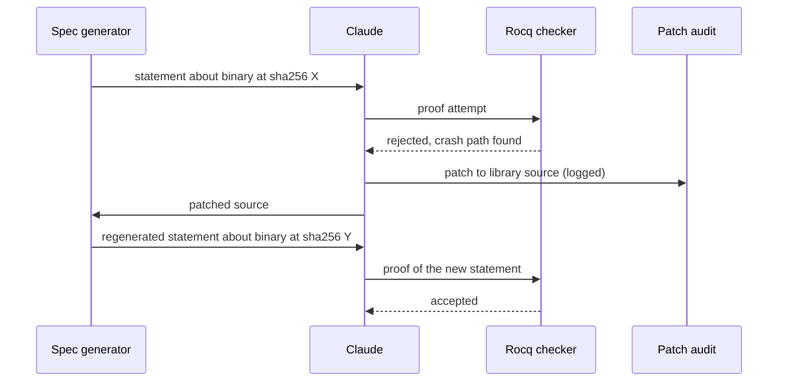

Your fuzz target checks a round trip: encode, decode, compare. When the bytes differ, it returns `-1`. The fuzzer runs for a week and reports nothing. A proof checker then certifies that the target never fails, on every input. Both are telling the truth, and the round-trip bug is still there.

That trap sits in the documentation of the project behind one of October's more interesting LLM results. On October 22, Anthropic and Theorem reported that Claude "proved security properties at the assembly code level (RISC-V)" across "239 entry points across 123 different OSS-Fuzz libraries." Most coverage stopped at the number. The part worth stealing for your own LLM application is the shape of the system. The model produces, a checker judges, and nearly all of the engineering goes into deciding what the checker is asked to accept.

## A checker only grades the question you wrote

The setup has three parts. A **spec** says what must be true. **Claude** writes a proof. **Rocq**, a proof assistant, checks that proof mechanically. Rocq doesn't trust the model, doesn't sample and doesn't have a mood. If the proof checks, the statement holds.

That sounds like the end of LLM unreliability, and for this one question it is. Anthropic's post is blunt about what it leaves open: "“Formally verified” does not mean “bug-free.”" and "a proof checker can't tell you whether your spec matches reality."

That's the same position you're in whenever you put a validator behind a model. It could be a SQL linter behind a text-to-SQL feature, a JSON schema behind an extraction call or a test suite behind a coding agent. The validator makes the output trustworthy *relative to the validator*. If the validator asks the wrong question, a passing result is confidently wrong.

## Turning a fuzz test into a theorem

Writing specs by hand doesn't scale to a hundred libraries, so the team didn't. They took "the approach of automatically converting their preexisting compilable test suites into a spec." The library and its existing OSS-Fuzz target are compiled to a static RISC-V binary. The spec says "the fuzz test won't crash for any input less than 64 MB."

The statements in Theorem's public repo are more precise than that summary. Each one "is about the exact bytes of one binary," pinned by SHA-256. It's written against LPS, a Rocq model of a single-threaded Linux process. For libexpat's `xml_parse_fuzzer_UTF-8`, the core statement is two lines:

```coq
Definition plain_halts : Prop :=
  halts_within_budget Budgets.Standard.lim_source Exits.ok_or_refused Images.plain.
```

In words: on every input within a 16 GiB memory budget, the binary exits with status 0 or 2. It never crashes, fails an assertion or hangs. There are sibling halts statements for the ASan and UBSan builds, plus "agrees" statements requiring that the sanitizer build and the plain build "write the same bytes and exit with the same status." The `plain_halts` comment ends with a **Not claimed** clause: "anything about what the program writes; anything about other compilers, architectures or libexpat commits." More LLM pipelines should write that sentence down.

Getting to a provable statement also meant reshaping the program. In every build of the expat target, "getenv() returns NULL, getpid() returns 1 and mkstemp() uses a fixed name, so the program depends only on its input." The enrollment instructions forbid threads, clocks, the network and the environment in fuzz targets. That isn't style advice. Anything the model of the process can't express is something nobody can prove.

## The worked example: a fuzz target that lies to the prover

Back to the opening. Theorem's rules for fuzz targets carry two explicit warnings. "Do not return -1 for a failed property. -1 counts as a pass, so the statement holds although the property fails." The second covers the old OSS-Fuzz habit of returning 1 for uninteresting input: "That return value makes the statement false."

The `-1` case is nasty because it fails silently twice. libFuzzer "reads -1 as 'do not add this input to the corpus', not as a failure," so plain fuzzing never reports it either. Here is the bug in a round-trip target, using a hypothetical `codec.h`:

```c
// roundtrip_fuzzer.c
// clang -g -fsanitize=fuzzer,address roundtrip_fuzzer.c codec.c
#include <stdint.h>
#include <stdlib.h>
#include <string.h>
#include "codec.h"  // size_t encode(const uint8_t*, size_t, uint8_t*);  writes <= 2*len+16 bytes
                    // size_t decode(const uint8_t*, size_t, uint8_t*);  writes <= MAX_IN bytes

#define MAX_IN 4096

int LLVMFuzzerTestOneInput(const uint8_t *data, size_t size) {
  if (size > MAX_IN) return 0;   // bound input-derived sizes so every run ends quickly
  uint8_t enc[2 * MAX_IN + 16], dec[MAX_IN];

  size_t n = encode(data, size, enc);
  if (n == 0) return 0;          // documented rejection: an expected outcome is `return 0`

  size_t m = decode(enc, n, dec);
  if (m != size || memcmp(dec, data, size) != 0) {
    return -1;                   // BUG: the fuzzer discards this input, the prover counts a pass
  }
  return 0;
}
```

The fix is one line: replace `return -1;` with `abort();`. The process now dies on a broken round trip, which a halts statement forbids. The proof obligation then becomes "decode really inverts encode on every input," which was the point all along.

Notice who has to know this. The model writing the proof can't spot it, because the spec it was handed is internally consistent. The rule lives in an enrollment skill that tells the agent working with a maintainer to "Ask the maintainer each question. Do not guess an answer," covering entry points, untrusted inputs and properties beyond no-crash. The spec is a product requirement, and the skill routes it to a human.

## The loop: prove, patch, regenerate, re-prove

Proving found bugs, "hundreds" of them, including "a rediscovery of CVE-2026-56132 in libexpat, which needed deeply nested input." So the loop needed a step that changes the code. Claude "patched the code, which caused the spec to be regenerated with that patched code," then proved the new spec.

Traced across the four parties, the danger is visible in the middle: the producer edits the thing its own output is judged against.



The Rocq checker at the end is honest about the new binary Y. Whether Y is still the library anyone wanted is out of its reach. Anthropic names the failure mode: "Claude could make any theorem provable by rewriting the program into one that trivially never crashes." A parser that rejects every input never crashes.

Their countermeasures were incentives plus humans: "we penalized any patch," offered "extra credit for proving which inputs it changes and how few they are," and "logged and audited the patches." Here is that incentive as a scoring function you could drop into your own agent loop. The weights are mine. The post doesn't publish theirs.

```python
from dataclasses import dataclass

@dataclass
class Attempt:
    proof_checked: bool             # the checker accepted a proof of the current spec
    patch_lines: int                # lines changed in the code under test (0 = no patch)
    narrowness_proved: bool         # also proved which inputs the patch changes
    changed_input_fraction: float   # share of inputs whose behaviour the patch changes

def score(a: Attempt) -> float:
    if not a.proof_checked:
        return 0.0
    s = 1.0
    if a.patch_lines:
        s -= 0.5                                   # any edit to the judged artifact costs
        s -= min(a.patch_lines, 200) / 1000        # bigger edits cost more
        if a.narrowness_proved:
            s += 0.4 * (1 - a.changed_input_fraction)  # earn some back by proving it's narrow
    return s

assert score(Attempt(True, 0, False, 0.0)) == 1.0          # proof, no patch: best
assert score(Attempt(True, 3, True, 0.001)) > score(Attempt(True, 3, False, 0.0))
assert score(Attempt(True, 150, False, 0.0)) < 0.5         # big unexplained rewrite: suspicious
```

A rejecting-everything rewrite has a `changed_input_fraction` near 1, so it earns nothing back. Run through the audit log, it's exactly the patch a reviewer should see first.

## What the headline number covers

Anthropic reports 239 entry points; the public repo has proofs for 60. The post says that "over the span of a few weeks," Claude patched what it found and proved no crashes "for 239 entry points across 123 different OSS-Fuzz libraries." The public `oss-verify-proofs` README currently says "60 entry points in 25 libraries have proofs." The checked-in statements for libexpat's `xml_parse_fuzzer_UTF-8`, the target behind the CVE story, are still marked `open`. Treat the larger figure as Anthropic's internal result and the repo as what you can re-check today.

The scope is narrow too. The proofs are about "single-threaded, static RISC-V binaries linked against musl libc," while most deployments are x86 or ARM with glibc. Leak detection is off, and there's no MemorySanitizer build, so uninitialized reads are out of scope. The repo's own README says "LPS is best effort and not complete." None of this makes the work smaller. It shows how much of the effort lives outside the model.

Cost is real as well. Anthropic says proofs "can take hundreds of millions of tokens." A typical one runs "to about 600,000 lines" of Rocq, against binaries with "a median length of 18,000 RISC-V instructions." That's fine for a parser millions of machines expose to the internet. It's absurd for a CRUD endpoint.

## Key takeaways

- **The checker is the easy part.** Budget your engineering for the spec, and write down a "Not claimed" line for every guarantee your LLM feature makes.
- **Derive specs from artifacts that already exist.** Fuzz targets, test suites and schemas scale. Hand-written specs don't.
- **Ask humans what "correct" means.** The model can't tell a fuzz target that lies from one that doesn't.
- **Charge the producer for touching the judged artifact.** When a model can edit what it's graded against, penalize edits, reward proof that they're narrow, and log every one for a human.

## Further reading

- [Anthropic — formal verification at scale with Claude and Theorem](https://www.anthropic.com/research/formal-verification)
- [theorem-labs/oss-verify-proofs — statements and Rocq proofs](https://github.com/theorem-labs/oss-verify-proofs)
- [libexpat xml_parse_fuzzer_UTF-8 statements (Statements.v)](https://github.com/theorem-labs/oss-verify-proofs/blob/main/projects/expat/xml_parse_fuzzer_UTF-8/Statements.v)
- [oss-verify — what gets proven](https://github.com/theorem-labs/oss-verify/blob/main/docs/what-gets-proven.md)
- [oss-verify — the add-project skill for enrolling a library](https://github.com/theorem-labs/oss-verify/blob/main/.claude/skills/add-project/SKILL.md)
- [theorem-labs/rocq-linux-process-semantics — the LPS model](https://github.com/theorem-labs/rocq-linux-process-semantics)
