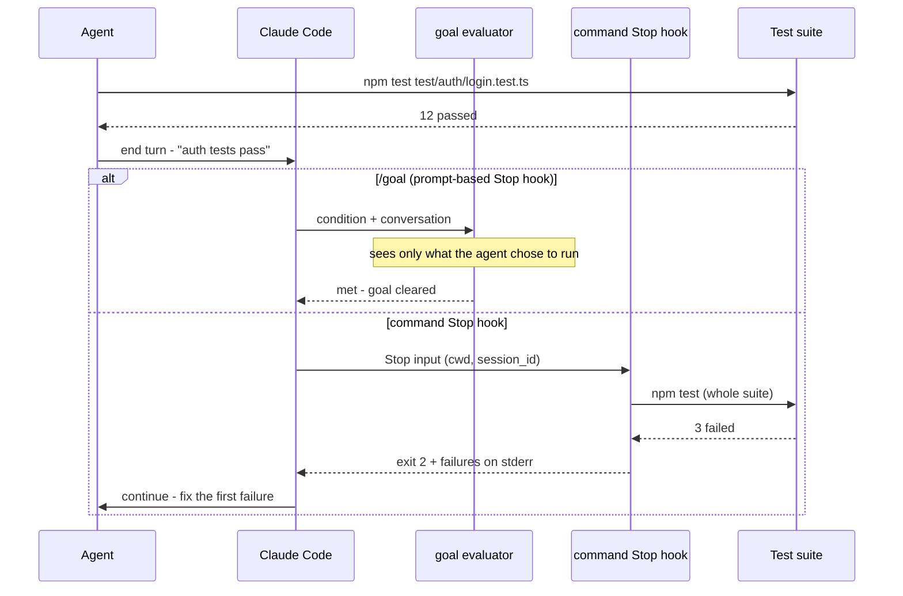

You type `/goal all tests in test/auth pass`, switch the session to auto mode, and go to lunch. When you come back the goal is marked achieved. You run the suite yourself and three tests fail.

Nobody lied. The agent ran the one test file it had been editing, that file passed, and the transcript said so. The evaluator that decided you were done never ran a test. It read the conversation, and the conversation looked green.

That gap is the most useful thing to understand about how the agent loop went from a joke-named bash script to a built-in command in two major coding agents. Something important was lost along the way, and you can get it back with about thirty lines of shell.

## The original was one line of bash and a lot of discipline

Geoffrey Huntley published **Ralph** on 14 July 2025. In his words, "In its purest form, Ralph is a Bash loop":

```bash
while :; do cat PROMPT.md | claude-code ; done
```

The loop is trivial. What made it work were the rules around it:

- **Fresh context every iteration.** Each pass starts a new process with an empty context window, and Huntley says to "deterministically allocate the stack the same way every loop": the same specs and the same plan, loaded the same way.
- **One thing per loop.** "Ask Ralph to do one thing per loop." The agent picks the most important item from a TODO list that Huntley says he watches "like a hawk".
- **Backpressure.** Tests, type checkers and static analyzers reject bad output. "Anything can be wired in as back pressure to reject invalid code generation."

The stop condition is not the model's opinion. It's the tests. The model proposes and the toolchain disposes, and when Ralph misbehaves you change the setup — "Ralph gets tuned - like a guitar" — rather than arguing with the output. Huntley's own summary is that the technique is "deterministically bad in an undeterministic world", which is exactly why it is debuggable.

## First productization: the loop moved inside the session

Anthropic's `ralph-wiggum` plugin for Claude Code turned the loop into a command:

```text
/ralph-loop "<prompt>" --max-iterations 20 --completion-promise "DONE"
```

The mechanism changed. The README says it outright: "The loop happens inside your current session - you don't need external bash loops." A Stop hook intercepts Claude's attempt to finish, returns `{"decision": "block", "reason": <prompt>}`, and "the prompt never changes between iterations". The hook stores its state in `.claude/ralph-loop.local.md`.

Two of Ralph's three rules didn't survive. Context is no longer fresh, because each iteration is another turn in the same window. And the stop condition is now a `<promise>DONE</promise>` tag that the model emits, checked by exact string match. The README is honest about where safety now lives: "Always rely on `--max-iterations` as your primary safety mechanism." The default is unlimited.

What survived is the outer shape: same prompt, repeated, until something says stop.

## Second productization: a second model decides you're done

Claude Code's `/goal` and Codex's Goals, which shipped in Codex CLI 0.128.0, are the grown-up version. Both make the completion condition a first-class object instead of a magic string.

In Claude Code, `/goal` is "a wrapper around a session-scoped prompt-based Stop hook". After every turn, the condition and the conversation go to a small fast model that answers *met*, *not yet met* or *impossible*. The docs make a real point here: completion "is decided by a fresh model rather than the one doing the work". That is a genuine improvement over the promise tag — the worker no longer grades its own homework.

But read the next line of the docs: the evaluator "doesn't run commands or read files independently". It judges what Claude has *surfaced in the conversation*. Codex takes the same position from the other side. The model "can mark an existing Goal complete only when the evidence supports completion", and "a Goal should not be marked complete because the model believes it is probably done". Evidence here means whatever ended up in the thread.

Put the three side by side and the trade is clear:

| | Context per iteration | Who decides "done" | What the check sees | Hard bound |
| --- | --- | --- | --- | --- |
| Ralph (bash) | Fresh process | The toolchain | The real repo | You hit Ctrl+C |
| `/ralph-loop` plugin | Same session | Exact string match on a tag the model emits | The model's last message | `--max-iterations` |
| Claude Code `/goal` | Same session | Separate small model | The transcript | Your condition text, plus a stall check |
| Codex Goals | Same thread | The working model, with evidence | The thread | A budget limit, which "is not the same as completing the objective" |

The products gained ergonomics, resumability, status views and budgets. They lost the property that made Ralph trustworthy: **the stop decision was made by something that looked at the code, not at the conversation about the code.**

## Where the check actually happens

Traced across one turn, the difference between a model-evaluated stop and a script-evaluated stop is a single arrow — whether anything goes back to the test suite after the agent says it's finished:



In the `/goal` branch, nothing after the agent's last message touches the repository. In the hook branch, the hook re-runs the real check no matter what the agent claims, which is Ralph's backpressure moved to the end of the turn.

## Put the backpressure back with a command Stop hook

The `/goal` docs point the way themselves: a Stop hook in your settings "can run a script for deterministic checks or a prompt for model-evaluated ones". Here is the deterministic kind. It refuses to let a turn end while the suite is red, and it gives up after a fixed number of attempts so it can't spin forever:

```bash
#!/usr/bin/env bash
# .claude/hooks/tests-green.sh
# Stop hook: the turn may only end on a green test suite.
set -uo pipefail

MAX_BLOCKS=20
input=$(cat)

# Background work (a subagent, a long build) means paused, not done.
pending=$(jq '(.background_tasks // []) | length' <<<"$input")
if [[ "$pending" -gt 0 ]]; then
  exit 0
fi

cd "$(jq -r '.cwd' <<<"$input")" || exit 0

# Our own budget, per session. Claude Code's built-in cap resets on every
# tool call, so a busy agent never hits it.
session=$(jq -r '.session_id' <<<"$input")
counter="${TMPDIR:-/tmp}/tests-green-${session}"

# The backpressure: run the real check here, not in the agent's transcript.
if output=$(npm test --silent 2>&1); then
  rm -f "$counter"            # green: reset the budget, let Claude stop
  exit 0
fi

blocks=$(( $(cat "$counter" 2>/dev/null || echo 0) + 1 ))
echo "$blocks" > "$counter"
if (( blocks > MAX_BLOCKS )); then
  echo "tests-green: ${MAX_BLOCKS} attempts used, handing back to a human." >&2
  exit 0
fi

# Exit 2 blocks the stop; stderr becomes Claude's reason to continue.
{
  echo "The test suite is still failing (attempt ${blocks}/${MAX_BLOCKS})."
  echo "Fix the first failure only, then stop."
  echo
  tail -n 40 <<<"$output"
} >&2
exit 2
```

Make it executable with `chmod +x .claude/hooks/tests-green.sh`, then register it in `.claude/settings.json`:

```json
{
  "hooks": {
    "Stop": [
      {
        "hooks": [
          {
            "type": "command",
            "command": "\"$CLAUDE_PROJECT_DIR\"/.claude/hooks/tests-green.sh"
          }
        ]
      }
    ]
  }
}
```

A few details are doing real work:

- **Exit 2 is the steering wheel.** For Stop hooks, a script that exits 2 "routes the same way as `reason`": the stderr text becomes the instruction for the next turn. Feeding back the tail of the failure output plus "fix the first failure only" is Huntley's one-thing-per-loop rule, enforced from outside.
- **The built-in cap won't save you.** Claude Code stops after "8-consecutive-continuation" blocks, but "the count of consecutive continuations resets each time Claude calls a tool". An agent that is actively editing calls tools every turn, so the counter in the script is the real budget.
- **Skip while background work runs.** `background_tasks` is how a hook tells "session is done" apart from "session is waiting on a subagent". Blocking a paused session would just burn a turn.

This doesn't replace `/goal`. Combine them: write the condition for the parts only judgement can assess ("the migration follows the design doc"), and let the hook own the part a script can prove.

## What the products still don't give you: state

Ralph had one more thing the products dropped quietly: the specs folder and the TODO list lived in the repo, in files, under version control.

The paper *Loop Engineering: Building Blocks, Adoption, and Impact* (arXiv 2608.21884) lists what a well-engineered loop needs: triggers, machine-checkable stop conditions, durable state outside the context window, an independent verifier, budgets, and defined escalation points to humans. Then the authors mined 36,645 repositories. They confirmed autonomous agent loops in 217 of them, and found that "almost none commits the state files the discourse prescribes". The loop configs are in git. What the loop knows is not.

That's the part of Ralph worth stealing on purpose. If your loop's plan exists only in a session transcript, it disappears when the session expires, and the next run starts from the prompt again.

## When the model-judged loop is the right call

`/goal` on its own is fine when the end state is genuinely a judgement — "every acceptance criterion in the doc holds" — and no script can decide it. It also costs almost nothing. The docs describe evaluation tokens as "typically negligible compared to main-turn spend", and staying in one context window spares the agent from re-reading the world each turn.

Reach for the hook, or for real Ralph with a fresh process, when "done" has a definition a computer can check. If the condition is "the tests pass", let the tests decide.

## Further reading

- [Geoffrey Huntley — Ralph](https://ghuntley.com/ralph/)
- [Claude Code `ralph-wiggum` plugin README](https://github.com/anthropics/claude-code/blob/main/plugins/ralph-wiggum/README.md) and its [stop hook](https://github.com/anthropics/claude-code/blob/main/plugins/ralph-wiggum/hooks/stop-hook.sh)
- [Claude Code docs — Keep Claude working toward a goal (`/goal`)](https://code.claude.com/docs/en/goal)
- [Claude Code docs — Hooks reference (Stop input and decision control)](https://code.claude.com/docs/en/hooks)
- [Claude Code docs — Automate actions with hooks](https://code.claude.com/docs/en/hooks-guide)
- [OpenAI Cookbook — Using Goals in Codex](https://developers.openai.com/cookbook/examples/codex/using_goals_in_codex)
- [Codex CLI release rust-v0.128.0](https://github.com/openai/codex/releases/tag/rust-v0.128.0)
- [Loop Engineering: Building Blocks, Adoption, and Impact (arXiv 2608.21884)](https://arxiv.org/abs/2608.21884)
